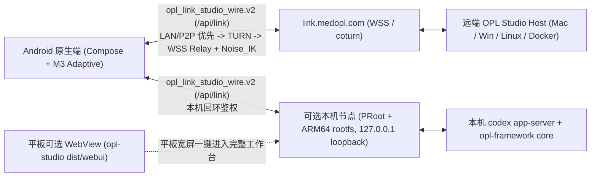

# OPL Link Android 与本机 Codex 节点规划

Owner: `one-person-lab-app`
Purpose: `android_product_architecture_and_delivery_plan`
State: `planned_pre_kickoff`
Related SSOT: [`opl-link.md`](opl-link.md) · [`app-remote-companion.json`](../../contracts/app-remote-companion.json) · [`app-remote-companion-wire.json`](../../contracts/app-remote-companion-wire.json) · [`app-remote-companion-internet.json`](../../contracts/app-remote-companion-internet.json) · [`app-remote-companion-extensions.json`](../../contracts/app-remote-companion-extensions.json) · [`app-shell-adapter.json`](../../contracts/app-shell-adapter.json)

> 本文档是近期大重构收尾后启动的 Android 端架构与实施规划，作为后续立项、PoC 与分阶段开发的单一参考基线；当前不修改任何已激活的机器合同，也不宣称 Android 端已实现或进入发布范围。

---

## 一、产品定位与路线取舍

Android 与 iOS 的本质差异在于系统开放度不同：iOS 无法在本地运行 `codex` 二进制，因此 `OPL Link` 在苹果生态严格定位为无本地执行器的远程伴侣；Android 具备 Linux 内核，可在用户态（如 PRoot + ARM64 Linux rootfs）运行标准 Linux CLI 与 Node.js 服务，但也受限于 Bionic libc、`W^X`、`Phantom Process Killer`、前台服务配额及应用商店审查政策。

结合现有 `opl-studio`（Headless WebUI + `opl-codex-native`）、`opl-link`（多电脑并发与 `/api/link` 协议）以及社区 `dsh-Go` 的实践经验，对三条可选路线对比如下：

| 对比维度 | 路线 A：全功能 OPL App 安卓版（WebView 套壳 + 全量 PRoot） | 路线 B1：OPL Link 安卓版 + 纯 DSH JS Harness（照搬 `dsh-Go`） | 路线 B2（选定路线）：OPL Link 安卓原生版 + 可选「本机 OPL Studio/Codex 节点」 |
| --- | --- | --- | --- |
| **与 OPL 架构一致性** | 仍是 Codex 权威，但手机易变成与桌面割裂的独立孤岛 | **冲突**：引入第二套 DSH Agent Loop、会话格式与模型路由，直接违背 [`app-shell-adapter.json`](../../contracts/app-shell-adapter.json) 的排除边界 | **完全一致**：无论远端电脑还是手机本机节点，统一走 `opl-studio` + `codex app-server` + `/api/link` |
| **包体与依赖负担** | 极重：基础包体 300–500 MB，附带 Python/Skills 后轻松超过 1 GB | 中重：约 150–250 MB（含 Ubuntu rootfs 与 Node 运行时） | **分层可控**：基础纯远程伴侣约 20–40 MB；本机引擎按需下载安装 |
| **商店合规与分发** | 难以通过 Google Play 审核，只能侧载 APK | 无法上架 Google Play（`dsh-Go` 仅作 APK 侧载） | **双轨兼容**：Phase 1 首发走 GitHub Releases APK 灰度，但代码底座保持 `targetSdk >= 35` 与 16KB 页对齐合规结构，保留未来随时上架 Google Play/国内商店的能力；Phase 2 本机引擎增强版继续以 GitHub Releases 侧载分发 |
| **手机 / 平板 UI 体验** | 手机小屏 WebView 体验受限（键盘遮挡、手势冲突、密集桌面控件） | 移动端交互流畅，但缺少完整桌面级面板与 OPL 插件体系 | **大小屏兼得**：手机/折叠屏原生自适应体验，平板一键可进本机完整 Studio WebUI |
| **真机稳定性与预期** | 桌面重技能（视频渲染、Playwright、LaTeX、CUA）在手机极易 OOM/被杀 | 轻量 JS 稳定，但同一批 OPL Codex Skills 与桌面表现不一致 | **主链路零风险**：远程电脑承接重任务 100% 稳定，本机节点聚焦轻量移动 Codex |

### 核心产品决定（路线 B2）

1. **单一产品入口，而非两个割裂 App**：Android 端统一以 **OPL Link** 作为产品载体，基础形态保持轻量原生远程伴侣，与 iOS 版共用相同的 Gateway 同账号发现与 `/api/link` 协议。
2. **「本机节点（Local Host）」抽象**：用户需要离线或无电脑时独立使用 Codex，可选择启用本机运行时，在本地拉起裁剪后的 `opl-studio` headless + 官方 `@openai/codex` + `opl-framework` core。在 OPL Link 的设备列表中，它以一台独立的本机 Host 与 Mac / Windows / Linux / Docker 主机平级呈现。
3. **平板工作台增强**：在宽屏安卓平板上，针对本机节点（及受信任的可直连节点）提供一键切入完整 `opl-studio` React WebUI 的内置 WebView 入口，兼顾轻量移动沟通与平板桌面化工作台需求。

---

## 二、总体架构与跨仓 Owner 分工

### 1. 运行拓扑

### 2. 跨仓 Owner 分工

| 职责域 | Owner | 边界与交付说明 |
| --- | --- | --- |
| **产品边界、跨端协议与本机节点合同** | `one-person-lab-app` | 维护 Android 产品规划；Phase 2 启动前新增本机节点机器合同与安全边界，不改坏既有 iOS `local_ios_runtime: false` 约束；定义跨端验收门禁 |
| **Android 原生客户端与本地运行时宿主** | `opl-link-android`（独立新仓） | Kotlin/Compose UI、Android Keystore 凭据存储、WebRTC DataChannel + `Noise_IK`、PRoot 宿主进程、Foreground Service 保活、`DocumentsProvider` + SAF 工作区桥接、Android 能力扩展 |
| **Headless Host 与 `/api/link` 桥接** | `opl-studio` | 复用既有 `/api/link` 路由、`scripts/headless/run.mjs` & `server.mjs`、`opl-codex-native`；Phase 2 提供 Android `linux/arm64` 精简 headless 产物清单 |
| **CLI 与账号认证桥** | `one-person-lab`（Framework） | 提供 `opl` CLI 核心状态/动作接口、Gateway 同账号认证与配置读写能力 |
| **公网中继与账号隔离服务** | `opl-link/service` & `opl-instance-medopl` | 既有托管 Relay / `coturn` 服务与部署；Android Phase 1 无需对服务端协议做破坏性改造 |

### 3. 为什么拆分为独立仓库 `opl-link-android`（而非放入 `opl-link/android/`）

- `opl-link` 根目录已由 iOS SwiftPM / XcodeGen 工程（`Package.swift`、`OPLLink.xcodeproj`）占用，并附带 `service/` 容器与对应 CI，强行塞入 `android/` 会让根目录工具链与 CI 边界混杂；
- Android 与 iOS 虽共享同一产品定位和 `opl_link_studio_wire.v2` 协议，但工程栈完全独立（Kotlin / Compose / Gradle / NDK / Linux runner），且 Phase 1 需通过独立 GitHub Releases 发 APK 灰度、Phase 2 引入 PRoot/JNI 宿主与 ARM64 rootfs 运行时包后工程体量与发布节奏将与 iOS 彻底分离；
- 跨端一致性继续由 `one-person-lab-app` 机器合同与公共协议 / Noise 测试向量保障，符合 OPL 家族按运行栈拆仓的边界。

---

## 三、Android 客户端技术选型与多形态 UI 适配（手机 / 折叠屏 / 平板）

### 1. 技术选型：Kotlin + Jetpack Compose + Material 3 Adaptive

不采用 Flutter 或 KMP 重写全端，选定纯原生 **Kotlin + Jetpack Compose + Material 3 Adaptive**，核心考量如下：

1. **保护既有 iOS 投资**：`opl-link` 已有成熟的纯 SwiftUI 实现与真机闭环，引入 Flutter 或 KMP 只会给现有 iOS 线带来迁移摩擦，而协议边界已由 [`app-remote-companion-wire.json`](../../contracts/app-remote-companion-wire.json) 与测试夹具清晰冻结，在 Kotlin 中对等实现协议客户端与传输层成本可控。
2. **原生系统深度能力最顺手**：Android Keystore 硬件密钥库、`DocumentsProvider` + Storage Access Framework（SAF）、Foreground Service 生命周期、JNI 封装 `libproot.so`、16KB 内存页对齐、通知/分享 Intent 以及按需 WebView 桥接，均以原生 Kotlin 为第一等公民。
3. **跨窗口形态自适应能力成熟**：Material 3 Adaptive 原生提供 `WindowSizeClass` 与 `ListDetailPaneScaffold`，可一套代码覆盖直板手机、折叠屏内外屏及大屏平板。

### 2. 三档窗口自适应布局（按窗口可用空间决策，禁止按机型硬编码）

| 窗口断点 | 典型设备形态 | 布局策略与状态连续性 |
| --- | --- | --- |
| **Compact (`< 600dp`)** | 手机竖屏、折叠屏外屏 | 单列对话优先；工具调用过程默认折叠；审批（展示动作原因、对象、范围与完整 diff）、结构化问题与附件上传采用底部 BottomSheet；严格处理 edge-to-edge 安全区与 IME 软键盘弹起避让 |
| **Medium (`600dp – 840dp`)** | 折叠屏展开态、小尺寸平板 | 左侧 `NavigationRail` + 自适应双栏（设备/会话列表 + 当前对话）；折叠/展开/横竖屏切换及分屏窗口调整时，必须完整保留当前选中的 Host、`canonical_thread_id`、输入框草稿、待处理审批身份及滚动阅读位置 |
| **Expanded (`>= 840dp`)** | 10"–13" 安卓平板、横屏、桌面模式 / DeX | 常驻多电脑与对话侧栏 + 主对话区 + 右侧辅助检查栏（文件预览、Git 变更或审批详情）；针对本机节点（及受信任直连节点）提供「打开完整工作台」入口 |

### 3. 平板内置完整 WebUI 桥接原则

`opl-studio-client` 现有的 `codexWorkbenchStyleResponsive.ts` 已具备宽屏以及 `max-width: 980px`、`max-width: 760px`、`max-width: 680px` 等断点基础，因此**平板端不需要重写一套桌面级 React 工作台**，可在 Expanded 布局中按需挂载内置 WebView 承载本机 `opl-studio` `dist/webui`，并重点补齐四项移动端兼容：
- 触控热区放大与原本依赖鼠标 hover 显示的操作按钮在粗指针（`pointer: coarse`）下常驻可见；
- 拦截 Web 文件选择请求，桥接至 Android 原生 SAF 文件选择器；
- 接管系统返回手势/物理返回键与页面内抽屉/弹窗关闭状态；
- 限制 WebView 仅允许连接本机受认证的 loopback 原点（Release 下禁止任意外跳或明文非回环连接）。

### 4. 交互与安全底线（对齐 [`opl-link.md`](opl-link.md)）

- 中性表面、克制强调色，品牌、连接与运行态**均不使用绿色强调**；
- 长文本原生渲染 GFM Markdown 与代码块复制，工作区文件区分引用与交付成果并提供系统预览/分享；
- 严格遵循无离线写队列：断线期间保留本地草稿但禁用 mutation；发送结果未知时展示不确定态并回读 canonical 状态，**禁止自动重播**；
- 账号会话、设备身份与每台电脑签发的 30 天 bearer 凭据按 origin / account / host 隔离存储于 Android Keystore 加密存储，不入普通日志与消息历史。

---

## 四、本机 `OPL Studio / Codex` 节点方案与依赖裁剪

### 1. 为什么不能直接运行 Linux 桌面发行版？

现有 Linux 桌面版是 `x64` Electron `.deb`（见 [`distribution-and-install-ssot.md`](../delivery/distribution-and-install-ssot.md)），无法直接在 Android 运行，根本障碍有四点：
1. **Electron 无法运行于 Android**：Android 无桌面窗口系统与完整 X11/Wayland 生态；必须跳过 Electron 壳，复用 `opl-studio` 的 `linux/arm64` Headless HTTP/SSE 架构。
2. **用户态 C 库与基础路径不兼容**：Android 用户态采用 **Bionic libc**，系统缺少 `/bin/sh`（在 `/system/bin/sh`）与标准 `/etc/resolv.conf`；而官方 `@openai/codex` 预编译二进制为 `aarch64-unknown-linux-musl`，直接运行常触发平台校验、DNS 解析与 shell 路径失败。
3. **`W^X` 与二进制执行限制**：Android 10+ 禁止直接从应用私有可写数据目录通过 `execve` 启动可执行文件；需要通过 `jniLibs` 打包的原生装载器或专用可执行包装策略运行。
4. **Linux 沙箱原语受限**：非 Root Android 环境无法提供完整 mount/user namespace、`bwrap` 或普遍可用的 Landlock。

### 2. 选定执行底座与抽象接口

将本机运行时后端抽象为 **`LocalHostRuntimeAdapter`**，避免业务逻辑与底层容器机制死绑：

- **近期落地实现（PRoot + 精简 ARM64 rootfs）**：
  - 通过 `jniLibs/arm64-v8a/libproot.so`（及配套装载组件）启动精简版 Debian/Ubuntu ARM64 rootfs；
  - rootfs 直接对齐 `opl-studio/Dockerfile` 的 `node:26-bookworm-slim` ARM64 基线，从而**原样复用官方 Node.js 26 `linux-arm64`、官方 `@openai/codex`（`aarch64-unknown-linux-musl`）与官方 `opl-framework`**，不维护脱离上游的私有 Bionic Codex 分支。
- **远期可扩展后端（AVF / Linux Terminal）**：
  - 随着 Android 15/16+ 基于 AVF（pKVM）的原生 Linux 虚拟机逐步普及，后续可在不改写上层 `opl-studio` 与 OPL Link 协议的前提下，把硬件虚拟化后端作为 `LocalHostRuntimeAdapter` 的高配实现接入。

### 3. Android 本机运行时裁剪清单

| 分类 | 组件 / 包 | 处理策略与原因 |
| --- | --- | --- |
| **保留（Core）** | Node.js 26 (`linux-arm64`) | 驱动 `opl-studio` headless 与 `opl` CLI 的基础运行时 |
| **保留（Core）** | `opl-studio` headless 精简集 | 保留 `src/host/dsh/host.mjs`、`scripts/headless/server.mjs`、`opl-codex-native`、`opl-dsh-tool-mcp`、`opl-framework-bridge`、`opl-host-core`、`opl-web-routes`、`dist/webui` |
| **保留（Core）** | 官方 `@openai/codex` (`linux-arm64`) | 由冻结依赖清单与 SHA-256 校验，通过标准 `codex app-server` stdio 接入 |
| **保留（Core）** | `opl-framework` CLI 核心 + `ca-certificates`、`git`、`curl` | 支撑 `opl app state/action`、TLS 根证书、HTTPS 与代码工作区操作 |
| **可选按需扩展** | 轻量 Python / `uv` | 不打入首发基础 rootfs，在 Phase 2 后期作为独立按需扩展包提供 |
| **明确剔除（Non-goals）** | Electron、`@deepseek-ai/dsh-cua-*`、`@deepseek-ai/libreoffice-kit`、`@roamhq/wrtc`、`sherpa-onnx`、`@playwright/mcp`（Chromium）、Docker、大体积离线媒体包、默认常驻 Temporal worker | 手机无桌面 CUA 窗口、无本机 WebRTC 中转需求（本机走 loopback）、无离线大型渲染/浏览器自动化算力与内存预算；非显式启用定时任务时不常驻 Temporal worker |

### 4. 本机节点的能力定位、隔离与安全边界

1. **与远端电脑彻底隔离**：
   - 基础远程模式保持“手机端零模型凭据、零本地历史权威”；
   - 只有用户显式启用「本机节点」后，才在设备内部创建独立 `hostDeviceId` 的本机 OPL Host、独立 `CODEX_HOME` 与受控工作区目录，**绝不与远端电脑的对话历史静默混合或覆盖**。
2. **沙箱降级与显式披露**：
   - `opl-codex-native` 默认权限档 `:danger-full-access` 可在无 root 的 PRoot 下正常拉起工具与命令；
   - Android PRoot 无法提供桌面级 `:workspace` / `:read-only` 的内核 `bwrap`/`landlock` 沙箱。本机隔离边界由 Android 应用私有沙箱 + 显式授权的工作区目录保障；界面须清晰披露此差异，选择受限沙箱档位时须显式拦截或提示风险，不得假装存在内核级容器隔离。
3. **移动本机功能边界**：
   - 聚焦 Codex 移动独立对话、代码与文档编辑、轻量 CLI/Git/Skill、离线草稿和本地文件交付；
   - 明确不承诺在手机本地运行桌面重型领域管线（如 `med-autocast` 视频渲染、Playwright 浏览器抓取、重型 LaTeX/Quarto 编译）。

### 5. 本机工作区存储方案（社区成熟实践）

- **默认采用应用私有高速内部存储（`context.filesDir` 下的受控 POSIX 目录，如 `workspaces/`）**：Android 外部共享存储（`/sdcard` 的 FUSE / `sdcardfs`）不支持完整 POSIX 权限（`chmod +x`）、软链接与文件锁，且小文件 I/O 比内部存储慢 5–10 倍，会导致 `git`、`npm`、`codex` 频繁异常；SAF 返回的 `content://` URI 也不是标准 POSIX 路径，CLI 工具无法直接读写。
- **用户文件互通补齐方案**：
  1. 仿照 Termux 实现轻量的 Android **`DocumentsProvider`**，把应用私有工作区安全暴露给系统「文件」App 及第三方编辑器（如 MT 管理器、Obsidian、代码编辑器），既享有原生 POSIX 性能，又能在系统文件管理器直接浏览与编辑；
  2. 在对话结果文件卡片提供一键预览、系统分享与 **SAF 导出（保存到下载/文档目录）**，在输入与工作区入口提供 **SAF 导入（从手机拷贝文件或文件夹进工作区）**。

### 6. 双形态分发策略

| 分发渠道与形态 | `targetSdk` 与原生要求 | 包体与包含内容 | 目标用户与合规定位 |
| --- | --- | --- | --- |
| **Phase 1 基础纯净版**（首发：GitHub Releases APK 灰度；架构保留商店合规） | `targetSdk >= 35`、所有 `.so` 强制 16KB 页对齐、无 `proot` 与动态可执行二进制下载 | 约 20–40 MB；纯原生 OPL Link 远程伴侣 | 面向连接 Mac/Linux/Cloud 电脑的移动用户，首发走 GitHub Releases 灰度，未来需上架 Google Play 或国内商店时可直接复用 |
| **Phase 2 本地引擎增强版**（GitHub Releases 侧载 APK） | 含 `jniLibs/arm64-v8a/libproot.so` 与装载器；严格校验可下载产物 | 底座约 35–50 MB；首次开启本机节点时按需下载经 SHA-256 校验的 ARM64 rootfs 运行时包（约 250–350 MB） | 面向需要手机离线独立运行 Codex、或在安卓平板上使用便携工作台的进阶用户 |

---

## 五、关键技术风险与工程对策

| 风险项 | 触发原因与真机表现 | 工程对策与兜底方案 |
| --- | --- | --- |
| **`W^X` 与高 `targetSdk` 限制** | Android 10+ 禁止从应用私有数据目录直接 `execve`；商店要求 `targetSdk >= 35` 与 16KB 页对齐 | 基础纯净版完全剥离 PRoot 与外部二进制加载；增强版在 Phase 0 验证「高 `targetSdk` + `jniLibs/lib*.so` 装载器」全链路可用性，仅在不可逾越时将侧载版与商店版做构建变体隔离 |
| **无本地真机下的厂商内核与 `proot` 兼容盲区** | 本地无安卓真机：ARM64 AVD 运行标准 AOSP Android 15/16，无法运行小米 HyperOS 等闭源系统镜像，也无法提前覆盖华为鸿蒙或厂商魔改内核的 `proot`/`seccomp`/`getcwd` 坑及真实蜂窝 NAT 直连率 | 本地仅按最新款小米手机与小米平板规格配置 ARM64 AVD 完成标准 AOSP 门禁并标记 `emulator_qualified`；厂商 ROM 内核兼容与真机网络穿透由 GitHub Releases 灰度反馈收集，**严禁将模拟器通过宣称为真机或 HyperOS 已验证**；PRoot 探测失败时仅局部降级禁用本机节点，绝不阻塞远端连接主链路 |
| **PRoot 下双栈 DNS `EAI_AGAIN` 与 `/etc/resolv.conf` 缺失** | Android 不维护 `/etc/resolv.conf`；部分 Wi-Fi 下 glibc 双栈并行解析会因 `AAAA` 超时导致 Node / Codex 网络失败 | 宿主机监听 Android `ConnectivityManager`/`LinkProperties` 变化，实时写入 rootfs 内 `/etc/resolv.conf`；内置 `options no-aaaa` 开关与 IPv4 优先兜底 |
| **Phantom Process Killer（32 子进程上限）** | Android 12+ 默认限制单应用派生的后台幽灵子进程总数（含终端、Node、Codex、MCP、Git/Python 工具链），超限会被内核静默 SIGKILL | 精简掉非必要常驻 daemon（Temporal worker 等）；限制并发工具子进程上限；在诊断面板实时观测活跃子进程数并提示高风险机型关闭限制或转用远端主机 |
| **Android 15+ 前台服务 6 小时配额与国产 ROM 杀后台** | `dataSync` 前台服务在 Android 15+ 存在 24 小时累计 6 小时配额，超时不 `stopSelf()` 会崩溃；小米 HyperOS 神隐模式/自启动限制在本地模拟器无法复现 | 仅在本机引擎启动或存在活跃 turn 时按需申请前台服务，空闲即时停止并响应 `onTimeout()`；提供电池优化/自启动白名单引导，并将国产 ROM 后台存活率作为 GitHub Releases 灰度观察指标；被杀后依赖 `opl-link` 断线重连协议自动重新拉起并 `readThread` 回读权威状态 |
| **PRoot I/O 性能与手机存储膨胀** | `ptrace` 文件系统映射导致大量小文件读写（`npm`/`git`）慢 2–5x；外部共享目录在 POSIX 语义下损耗更严重 | 沿用第 4.5 节 `filesDir` 内部高速目录 + `DocumentsProvider` + SAF 导入/导出方案；设置页透明展示本机节点磁盘占用明细，提供一键清理缓存与完整卸载重置 |

---

## 六、分阶段实施路线与验收门禁

### Phase 0：ARM64 虚拟机技术验证 PoC（2–3 天，Go / No-Go 门槛）

在大重构收尾后**第一时间启动**，目标是在不写完整产品 UI 的前提下在模拟器环境验证技术可行性：
- **测试环境**：Apple Silicon Mac 上的 **ARM64 Android 15/16 AVD**（按最新款小米旗舰手机与最新款小米平板的屏幕尺寸、分辨率、DPI 与内存规格建立两套 Device Profile；不做真机测试）。
- **验证内容**：
  1. 在 `proot` + 精简 ARM64 Debian/Ubuntu rootfs 中成功运行 `node scripts/headless/run.mjs` 启动 `opl-studio`；
  2. `opl-codex-native` 成功拉起官方 `@openai/codex`（`codex app-server`），完成至少 10 轮真实对话、HTTPS 外部请求及 `filesDir` 工作区文件读写工具调用；
  3. 验证 `opl app state --profile fast --json` 在容器内正常返回；
  4. 模拟锁屏/Doze 切后台 15 分钟，观测进程存活情况与恢复能力。
- **量化门槛与结论口径**：
  - 本机引擎冷启动时间 `< 8–10 秒`；空闲常驻内存（RSS）`< 500 MB`；连续多轮对话与文件操作无 DNS `EAI_AGAIN` 或 `seccomp` 致命崩溃；常态子进程数峰值远低于 32 个上限。
  - Phase 0 只出具 **`emulator_qualified`** 结论；厂商 ROM（如 HyperOS）后台限制与非标准内核 `proot` 兼容列为后续 GitHub Releases 灰度观察项。

### Phase 1：OPL Link Android 原生远程伴侣（约 3–5 周）

- **交付范围**：
  - 在 `opl-link-android` 基于 Kotlin + Jetpack Compose + Material 3 Adaptive 实现手机 / 折叠屏 / 平板自适应界面；
  - 对接既有 `opl_link_studio_wire.v2` 与 `opl_link_internet.v1`（服务端零破坏性改动）：Gateway 同账号登录与多电脑并发发现、120s 手工二维码配对兜底、自动选路（`LAN/P2P → TURN → WSS Relay`）与固定公钥 `Noise_IK` 加密通道；
  - 对话历史/SSE 实时输出、过程折叠、插话（steer）与中断、完整 diff 审批、结构化问题、512 KiB 分段文件上传/下载及系统分享、本机连接诊断与增量流量统计；
  - 实现 `targetSdk >= 35` 与 16KB 页对齐合规构建，首发通过 `opl-link-android` **GitHub Releases APK 灰度分发**。
- **验收门禁**：最新款小米手机与小米平板规格 ARM64 AVD 全链路通过（含手机/平板自适应布局、旋转/分屏状态连续性、局域网/公网 TURN/WSS Relay 切换、断线后未知 mutation 不重播、桌面端撤销即时断开、`targetSdk >= 35` + 16KB 页对齐），发布说明如实标注当前为 `emulator_qualified` 灰度版，待灰度反馈补齐真机证据。

### Phase 2：本机 `OPL Studio / Codex` 节点 + 平板完整 WebUI 入口（约 4–8 周）

- **前置条件**：在 `one-person-lab-app` 补齐 Android 本机节点产品合同与安全边界，确认不影响现有 iOS 契约。
- **交付范围**：
  - 在 `opl-studio` 建立 Android ARM64 精简 headless 产物打包与清单校验（含精确 `@openai/codex` 版本与 SHA-256）；
  - 在 `opl-link-android` 实现 `LocalHostRuntimeAdapter`：按需下载/校验/解压/升级/卸载 rootfs 运行时、DNS 同步、Foreground Service 托管、回环端口隔离鉴权与 `DocumentsProvider` + SAF 工作区导入/导出；
  - 将「本机」注册为 OPL Link 设备目录中的独立节点，支持与远端电脑并列查看、新建与续聊；
  - 平板 `Expanded` 布局接入内置 WebView，提供「打开完整 Studio 工作台」与 SAF 文件桥接。
- **验收门禁**：在小米手机与小米平板规格 ARM64 AVD 完成离线对话与文件交付、`DocumentsProvider` 读写及 SAF 导入/导出、平板内置完整 WebUI、本机节点与远端电脑并发切换零串线程/串目录、磁盘占用透明与一键卸载不留残余、PRoot 异常时局部降级不阻塞远端伴侣；随后通过 GitHub Releases 侧载灰度收集真机兼容反馈。

### Phase 3：Android 原生手机能力扩展（按需迭代）

- 严格遵守 [`app-remote-companion-extensions.json`](../../contracts/app-remote-companion-extensions.json) 的请求级隔离铁律（默认关闭、当前请求显式选择、不向普通桌面或远程对话全局注册工具、撤权/超时仅令当前扩展失败）；
- 按需分批实现日历、提醒、位置、用户选图（去元数据重编码）、系统 Share Sheet 接收内容发起对话，以及可选的 Android 通知上下文/无障碍屏幕上下文（严禁未经单次显式授权的后台采集或第三方界面自动操作）。

---

## 七、已拍板启动基线（Pre-Kickoff Locked Decisions）

| 决策项 | 已确认结论 | 说明与边界 |
| --- | --- | --- |
| **1. 源码仓布局** | 独立新建 **`opl-link-android`** 仓库，不放入 `opl-link/android/` | `opl-link` 专注 iOS Swift 与 `service/` 容器；跨端协议与安全边界继续以 `one-person-lab-app` 为唯一 SSOT，并共享测试向量 |
| **2. 测试与验证基线** | 不做本地真机测试，采用 **ARM64 Android 15/16 AVD（按最新款小米旗舰手机与小米平板规格配置 Profile）** 验收 | 本地门禁仅代表 `emulator_qualified`；HyperOS 后台策略、真机内核 `proot` 兼容与真实蜂窝网络穿透由 GitHub Releases 灰度期收集 |
| **3. 本机工作区存储** | 默认采用**应用私有高速内部存储（`filesDir` POSIX 目录）+ `DocumentsProvider` + 系统分享 + SAF 导入/导出** | 保证 `git`/`codex` 完整 POSIX 语义与高性能，同时允许系统文件管理器与外部 App 安全读写和导入导出 |
| **4. Phase 1 首发渠道** | 通过 `opl-link-android` **GitHub Releases APK 灰度** 首发纯远程伴侣 | 同步保持 `targetSdk >= 35` 与 16KB 页对齐合规底座，为后续随时上架 Google Play 或国内应用商店留足余地 |
