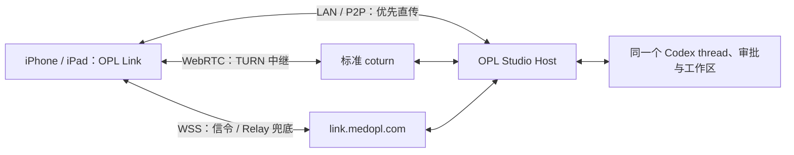

# OPL Link：OPL App 的 iOS 手机伴侣

Owner: `one-person-lab-app`
Purpose: `opl_link_product_and_delivery_ssot`
State: `active`

OPL Link 让用户离开电脑后，在 iPhone 或 iPad 上找到 OPL App 的已有对话、了解执行进展、
继续提问、回应审批与问题，以及预览和分享结果文件。桌面仍然持有同一个 Codex thread、模型、
权限、工作目录与工具。手机是原生操作和阅读界面，不运行第二个 Agent，也不建立另一份历史权威。

## 产品定位与扩展原则

OPL Link 的唯一主要任务是作为 OPL App 的手机伴侣，让用户远程操作电脑上的同一套对话、执行、
审批和工作区文件。配对、在线状态或手机端开关只解决连接问题，不改变普通电脑对话的工具目录、
提示词或执行权限。

日历、提醒事项、位置、照片、音乐、健康摘要和一次性闹钟等手机能力属于可选扩展，独立合同见
[`app-remote-companion-extensions.json`](../../contracts/app-remote-companion-extensions.json)。这些能力默认关闭；
模块授权不等于当前请求授权，手机来源也不等于所有手机工具均可用。只有用户为当前请求明确选择、
且模块授权、设备能力、活动租约、可信手机来源和 canonical thread owner admission 同时成立时，
才可向该请求提供选中的工具。下一条请求默认恢复关闭，工具目录和授权不得黏在 thread 上。

当前扩展合同已锁定，但运行时保持禁用。Codex 当前公开的 turn start/steer 接口没有经过验证的按请求
动态工具入口，因此不能用全局注册、关键词猜测或 prompt 文本模拟隔离。扩展异常、拒绝、超时或权限
撤销只能影响该扩展，不得阻塞配对、对话、审批、文件和自动重连等主要能力。

### 默认值与请求范围

2026-11-17 确认以下默认行为，桌面和手机端遵循同一规则：

| 场景 | 当前请求的手机扩展 |
| --- | --- |
| 电脑开发、制作科普视频；手机只是配对或在线 | 无工具、无手机能力提示词，沿用原有对话与设置 |
| 从 Link 继续普通电脑对话 | 与电脑普通请求相同，不因输入来自手机而开启扩展 |
| 手机为本次请求明确选择某项能力 | 仅提供选中且符合授权与设备声明的工具 |
| 电脑为本次请求明确选择某台已配对手机及能力 | 仅绑定这台手机和当前请求；不使用“最后在线的手机”推断来源 |
| 下一条请求、切换对话、重新连接或返回前台 | 默认关闭，不恢复上次的工具目录或请求授权 |
| 权限被拒绝、手机后台/离线、租约过期或扩展失败 | 停止该扩展；普通远程功能继续可用 |

模块开关按精确电脑—手机授权关系持久保存，初始关闭；iOS 系统授权继续由 Apple 持有。
“本次使用”是独立的临时选择，提交后重置，不能设为所有对话默认开启。运行中的补充要求不能扩大
当前 turn 的扩展权限，也不能悄悄继承旧选择。模型可以解释和建议某项能力，但关键词或模型判断不能代替
用户选择。请求绑定 host、phone、thread、request、turn 和当前 lease；旧回包不能写入另一请求。

用户明确请求的扩展不可用时，说明原因并提供继续普通请求的选择，不悄悄更换手机或改写任务。
模块关闭、撤权、断线、进入后台、超时或 turn 结束应清理扩展作用域；结果不明的写入只核对，不自动重试。
已返回的日历、位置等结果可以保留在同一 canonical 历史中；撤权不代表历史已被删除，后续请求也不能凭
历史恢复工具或权限。用户主动上传照片/文件属于现有主功能，不依赖新的手机连接器。

### 复用决定与实现顺序

采用 [dsh-mobile](https://github.com/Clarklevis1995/dsh-mobile/tree/d584e712980be3ab386f9f8d72ac88d94ba7ae6e)
的原生 Apple API 边界，以及
[dsh-plugin-mobile-gateway](https://github.com/Clarklevis1995/dsh-plugin-mobile-gateway/tree/0adcec73f54aaba1a2ab56443bcffd9d7879525c)
的设备租约、参数/结果校验与取消处理作为固定 MIT 复用来源。实施时记录实际复用文件、原 revision、
必要适配及 MIT 版权，不引入整套 KMP、第二 Gateway/Agent 执行器或上游视觉品牌。

上游 Gateway 全局注册手机工具，来源提示只控制 prompt，不能满足本合同对普通对话工具目录的要求。
当前 Studio 的 DSH MCP 同样暴露全局 registry，未携带可信的当前请求来源；不能仅在调用时拒绝来掩盖
schema 已经进入普通对话的问题。本次核对的 Codex CLI 0.167.1 只在 `thread/start` 声明 `dynamicTools`，
`thread/resume`、`turn/start`、`turn/steer` 均没有同等输入。为新建 thread 固定工具、常驻 dispatcher、
全局 `tools/list_changed` 或另开执行器，都不能证明已有普通对话的按请求隔离。

因此先完成可信的请求级工具入口验证，再实现原生适配。能力按以下顺序逐批交付，各批默认关闭、独立验收：

| 批次 | 目标 | 平台及数据边界 |
| --- | --- | --- |
| 第一批 | 日历、提醒事项、位置/地图、用户选图 | 日历忙闲和无邀请的新建；提醒查询/新建；位置仅前台按需；照片限用户选择并去元数据重编码，不读取整库 |
| 第二批 | 音乐 | 系统曲库及播放控制，分别核对授权和可用性 |
| 第三批 | 健康摘要、一次性闹钟 | HealthKit 只读、最多八天，缺失保持 null；AlarmKit 限 iOS 26+ 且只管理本 App 创建的闹钟 |

这些 API 不提供微信等任意 App 的界面控制，也不管理苹果“时钟”的既有闹钟。上游手机新版健康结果
与上述固定 Gateway 版本存在 schema 差异，实施时须在薄适配处统一并验证，不能混用后宣称兼容。
本次没有读取用户日历、位置或健康数据，没有创建提醒或闹钟，也没有据调研认定扩展已实现。

### 后续开发的准入与验收

新增功能先明确用户要完成什么、与主要用途的关系、实际 owner、默认值、失败影响和验收方式，再修改
App 合同及真实调用方。“有比没有好”不能成为改变主功能默认逻辑的理由。Link、Studio 的文档只描述
实现和链接本合同，不独立改变产品定位。

启用每批扩展前，须证明普通桌面对话与普通手机远程对话的工具、提示词、权限、执行器和超时路径不变；
显式请求只看到被选中且获准的能力；下一请求与并发其他 thread 不继承；撤权和旧租约立即失效；
失败不影响配对、续话、审批、文件及恢复。涉及 Apple 权限和前台限制的行为以真机实测为准。当前 wire
方法闭集保持原样，未来扩展路由须另行更新合同及客户端/Host，不把规划写成现有接口。

2026-11-15 用户重启开发，并授权按当前产品目标破坏性替换旧 Link 实现。旧代码的兼容与保留不再
构成本次要求。当前产品合同是 [`app-remote-companion.json`](../../contracts/app-remote-companion.json)，
跨端接口由 [`app-remote-companion-wire.json`](../../contracts/app-remote-companion-wire.json) 持有，
托管互联网连接由 [`app-remote-companion-internet.json`](../../contracts/app-remote-companion-internet.json) 持有。

## 设计目标

设计参考与工程复用分别决策。学习成熟产品的交互，不让候选代码的改造难度决定体验上限。

| 参考 | 采用的设计理念 | 在 OPL Link 中的表现 |
| --- | --- | --- |
| [DSH Go](https://github.com/ccch1mneyyy/dsh-Go) | 主要视觉参考，完整工作流、清楚的运行状态与成果交付 | 中性底色与清晰正文；区分执行、等待、失败和完成；支持插话与停止；结果文件具有预览、下载和分享动作 |
| [Fish Pocket](https://github.com/imsai-sh/fish-pocket) | 原生 iOS 交互参考 | 正文优先；过程默认折叠；审批与问题使用底部面板；采用 OPL 自己的视觉规范 |
| [Agents Anywhere](https://github.com/anywhere-labs/Agents-Anywhere) | 设备、项目和会话的清楚归属 | 当前设备和项目可见；从最近对话、项目分组或待处理请求进入工作 |

上述项目是设计参考，不因此引入其本机运行时、账号、云平台、品牌或受限素材。代码复用须单独核对
确切目录及授权；本轮原生客户端和 Studio 适配使用 OPL 自有实现、Apple 平台组件与许可适合的
成熟阅读组件。正文使用 MarkdownUI 渲染 GFM 表格、列表和代码块，代码支持复制；Markdown
和文本文件使用原生阅读路径，其他受支持格式使用 Quick Look，文件通过系统分享导出。

2026-11-15 用户指定 DSH Go 为主要视觉参考。OPL Link 采用中性表面、克制的交互强调色和原生
控件；品牌、连接和运行状态均不使用绿色强调。状态使用文字、图标及必要动态效果表达。

## iPhone Duo 与可变窗口

布局根据当前窗口可用空间和系统安全区调整，覆盖 Duo 外屏、展开内屏、旋转与窗口缩放。
展开后提供适合阅读和导航的分栏；窄窗口保留完整的单列工作路径。沿用系统导航和工具栏对
纵向状态区的适配，输入、审批与文件动作保持可达。

折叠、展开与尺寸变化保留当前电脑、canonical thread、草稿、待处理请求身份和阅读上下文。
专项验收使用真正的 iPhone Duo 模拟器运行，分别回读外屏、内屏、浅深色、放大字体、键盘与
审批面板；截图尺寸和 iPad 演示不能单独证明 Duo 适配。真机体验另行记录。

## 用户闭环

桌面在“设置 → 资源 → OPL Link”开启手机访问，复用已有 OPL 账号；需要登录时在 App 原有账号页完成。
桌面显示就绪后生成一次性二维码，手机扫码或粘贴链接，核对电脑指纹后进入对话。服务地址内置，
用户无需在 App 和 Link 之外安装软件、配置域名、证书、端口或隧道，手机无需输入账号密码。

Studio 的原生 Link 面板是桌面唯一的普通配对与设备管理入口。旧版
`remote_companion_access` 保留为兼容数据，不与原生面板同时显示；微信继续通过
`channel_access` 提供独立连接功能。

用户从已有对话开始，也可以在选中的设备上新建对话。项目分组是对 canonical workspace 的只读
导航投影；本地置顶、草稿和阅读位置属于设备偏好，不重写 thread 历史或项目身份。

打开对话后先显示 canonical 历史，再接收同一个 App Server 的实时事件。工具过程默认折叠，正在
等待的审批和问题保持可见。用户可以继续发送、在运行中补充要求或停止当前 turn。现有对话沿用
桌面已确认的设置；模型和思考深度只在真实能力可用时提供显式选择，不隐式重置权限。

审批显示动作原因、对象与范围，并给出允许和拒绝；结构化问题保留选项、自由回答及明确提交。
只转发当前真实 pending request 支持的响应，不在手机生成额外授权或扩大权限。文件修改审批
展示对应请求的路径和 diff；取得完整范围后才提供允许按钮，否则保留拒绝与回电脑处理入口。

文件卡片帮助用户直接取走成果：报告、PPT、表格、图像等可预览和通过系统分享。引用文件、
本轮修改和本轮交付需要明确区分；工作区浏览不把目录中的所有文件都称为当前成果。下载始终
绑定 canonical thread workspace，保留真实路径与符号链接边界。

## 当前架构

本轮用户批准的网络目标为 LAN/P2P→TURN→Relay 自动选路，同一扫码流程适用于局域网和互联网。
成功直连时，正文和文件由电脑与手机互传；TURN 及 WSS Relay 分别承担无法直连时的中继，
托管服务继续负责授权、在线状态、信令和撤销。目前上线情况以[直连验收](gui/evidence/opl-link-direct-first-acceptance-2026-11-15.md)为准。
电脑保持在线并运行 App；
电脑休眠或离线时，手机保留草稿并显示连接状态。用户电脑无需开放入站端口、配置 NAT 或与手机处于同一局域网。

所有业务路径保持电脑公钥固定的 Noise IK 加密。传输复用 MIT DS Harness Remote 的固定上游版本、
WebRTC 选路、WSS 信令、Relay、Noise IK 和 `loopback.call`。
每个已认证账号使用独立的原版 Gateway 与 Store；scope header 只负责路由，设备 token 与精确
电脑—手机 grant 负责授权。Relay 保存公开设备身份、令牌摘要和连接映射，不保存账号密码、模型 Key、
对话正文或文件明文。端到端业务加密固定至扫码选择的电脑公钥；更换身份必须显式重新配对。

有效的普通账号与管理员账号均可开启手机访问，两者使用相同的伴侣权限。Gateway 管理员角色
不传递给手机，也不开放 Gateway 管理接口；正式跨账号隔离验收继续使用专用普通账号。

Studio 复用当前 DSH Application Host 的 lifecycle 和受限 `/api/link` 路由，不加载 `dsh-base`，
不另起 Codex App Server。进程内固定虚拟目标 `http://127.0.0.1:43177` 不监听端口，只接受手机
业务路由；桌面设备管理、通用 App action、Package 与任意 shell 均不经此桥开放。

上传接口每片上限为 512 KiB，托管客户端采用 128 KiB，避免 HTTP 桥封装后的请求在慢链路上超过单次 RPC 预算。
完成摘要核验后仅向 turn 传递绑定当前设备和精确 thread/workspace 的
`uploadId`。保留每文件 10 MiB、最多五个限制。下载采用 512 KiB 分段及 ETag/If-Match，最多 256 MiB；
文件变化时丢弃不完整结果。SSE 沿用同一 Host 的事件源，以有界读取承载；重连后先回读 canonical 状态。

现有可信 HTTPS 直连接口保留为高级入口；默认设置流程不要求用户填写 URL。Release 客户端拒绝明文
HTTP、无效证书和跨 origin 重定向；Debug loopback 只用于隔离验收。方案选择、上游来源与当前部署
证据见[互联网接入](opl-link-internet-access.md)。

## 配对、设备与恢复

桌面已认证用户创建 120 秒有效的单次配对链接。成功兑换后，Studio 签发 companion scope 的设备
凭据；手机写入 Keychain，Host 只持久化 token hash 与设备元数据。设备凭据有效期为 30 天。
配对码通过固定电脑公钥的 Noise 通道发送；Relay enrollment 只建立传输身份。手机的传输身份和凭据
按服务 origin、账号 scope、电脑 ID 分开保存在 Keychain。配对码、二维码和 bearer 不进入日志、
普通偏好或消息历史。桌面先持久撤销业务凭据、关闭事件流，再撤销 Relay 授权。手机先取得本机
撤销 ACK，再自撤 Relay token 并清除当前电脑凭据；未知结果保持可见且不自动重发。

每个 mutation 使用独立 request ID，Host 拒绝相同 ID 的不同操作。连接中断、超时或结果未知时，
手机显示真实的不确定状态并回读 canonical 对话，不自动重发消息、审批或停止动作。离线保留草稿，
禁用写动作；恢复后重新读取设备状态、目录、当前 thread 和 pending requests。

桌面保持手机访问开启时自动恢复掉线的互联网连接，并按退避间隔重试；手动重新连接保留为
补救动作。恢复沿用已保存的设备身份，不因电脑改名要求重新配对。连接诊断显示实际路径和
最近失败原因，不能以手动点击恢复代替自动恢复的实现。

系统挂起后的即时更新不属于当前连接能力。回前台必须同步；小组件、Live Activity 或通知只表达
已取得的真实状态。没有推送服务时，不承诺 App 被结束后仍能即时收到进展。

## Owner 与交付

| 主题 | Owner |
| --- | --- |
| 产品定位、体验、安全边界与跨端 wire | `one-person-lab-app` |
| iOS/iPadOS UI、Keychain、客户端恢复和 Apple carrier | `opl-link` |
| 当前桌面 Host 的配对、设备鉴权、有限路由、事件和文件桥接 | `opl-studio` |
| 账号会话兑换与私有凭据文件桥 | `one-person-lab` 现有 Gateway account owner |
| 托管 Relay、账号隔离、传输令牌和容器源码 | `opl-link/service` |
| 受保护部署、持久化、Ingress/TLS 和公网资格 | `opl-instance-medopl` |
| canonical 对话、turn、模型、权限和审批 | 当前 `opl-codex-native` 与 Codex App Server |
| 文件内容、真实工作区及路径准入 | 现有 workspace owner |
| Package 与领域任务生命周期 | 原 Framework 与领域 owner |

验收顺序是产品与接口合同、Host 与客户端行为检查、原生构建、source Host 到模拟器的同一对话闭环、
真实界面审看。Demo 只用于界面状态；source 联调不代替已安装 App 或真机网络验收。

本次源代码与文档更新进入各 owner 的远端 canonical `main`。桌面安装更新、真实 iPhone 的 HTTPS
网络与前后台恢复、Apple 签名和公开分发分别回读，不由本地测试推导。当前任务不启动外部 TestFlight
或 App Store 发布。旧 Apple build 证据不证明 v2 的发布状态。

2026-11-15 已完成原生构建、界面审看与真实 Codex 到模拟器的同一对话续聊、前台恢复和文件正文
预览。详细范围与源码组合见[源码验收记录](gui/evidence/opl-link-native-companion-acceptance-2026-11-15.md)。

随后完成 DSH Go 视觉方向与真正 Duo 模拟器的外屏、展开、半开、旋转、键盘、草稿及审批
连续性检查；浅深色与辅助功能大字体检查同时修复了正文重复缩放、主按钮对比和问题面板高度。
普通 iPhone 与独立 iPad 保留代表路径回归。详细范围见
[视觉与 Duo 验收](gui/evidence/opl-link-dsh-go-duo-acceptance-2026-11-15.md)。这项模拟器资格
不改变桌面安装、真实 iPhone 网络与 Apple 分发的验收状态。

本轮托管互联网适配已完成源码、跨语言及本地原生闭环，容器已发布、现有节点专用静态 Store 已准备。
用户已完成 GitHub 验证并批准单包只读授权，公网服务已部署并通过固定镜像、工作负载及 HTTPS 健康回读。
专用零余额普通测试账号已创建，公网双账号隔离、加密往返与撤销断连已通过。
公网原生链路也已在 Duo 模拟器通过，业务执行使用隔离测试 fixture。随后已接入完整自适应选路，
本地原生 LAN、TURN 与失败后 Relay 均通过；公网默认选路实际回退 Relay，公网 forced-TURN 也已完成
同一业务 owner 的附件、下载、事件、重新连接与撤销闭环。公网 P2P 尚未实际选中。
复用依据与成本见[连接方案评估](opl-link-connection-options.md)，本轮实际路径与边界见
[直连验收](gui/evidence/opl-link-direct-first-acceptance-2026-11-15.md)，初次上线见
[托管互联网验收](gui/evidence/opl-link-internet-acceptance-2026-11-15.md)。

2026-11-16 的[真实 iPhone Duo 验收](gui/evidence/opl-link-physical-device-acceptance-2026-11-16.md)
已覆盖配对、续话、文件预览、前后台恢复和前台 Wi-Fi→蜂窝切换。用户随后确认的
“Enable UI Automation”来自 Xcode/XCTest 的系统自动化授权；普通 Link 启动和配对不请求这项
认证。该系统文案由 Apple 提供，不是 Link 的应用内标题。
