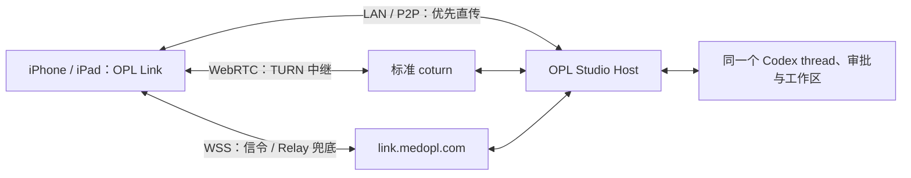

# OPL Link：OPL App 的 iOS 手机伴侣

Owner: `one-person-lab-app`
Purpose: `opl_link_product_and_delivery_ssot`
State: `active`
Machine contracts: [`app-remote-companion.json`](../../contracts/app-remote-companion.json) · [`app-remote-companion-wire.json`](../../contracts/app-remote-companion-wire.json) · [`app-remote-companion-internet.json`](../../contracts/app-remote-companion-internet.json) · [`app-remote-companion-extensions.json`](../../contracts/app-remote-companion-extensions.json)

OPL Link 让用户离开电脑后，在 iPhone 或 iPad 上找到 OPL App 的已有对话、了解执行进展、继续提问、回应审批与问题，以及预览和分享结果文件。桌面仍然持有同一个 canonical Codex thread、模型、权限、工作目录与工具。手机是原生操作和阅读界面，不运行第二个 Agent，也不建立另一份历史权威。

## 产品定位与用户闭环

默认流程采用同一个 OPL Gateway 账号（`gateway.medopl.com` 认证）。桌面 App 登录后自动开启手机访问；用户可在“设置 → 资料与连接 → 远程访问与网页端 → OPL Link”关闭手机访问，关闭状态跨重启、升级和重新登录保留。OPL Link 登录同一账号后发现开启了手机访问的在线电脑，并为在线电脑分别建立连接：

- **多电脑并发视图**：「全部电脑」按电脑和项目展示已载入的对话及待处理请求，切换到单台电脑只改变列表范围。已有对话的消息、审批和文件操作始终发往该对话所属的电脑；多台可用时，从「全部电脑」新建对话需选择执行电脑。
- **容错启动与配对兼容**：电脑注册在后台完成，Gateway 或 Link 服务暂不可用时桌面仍可启动。保留桌面生成 120 秒有效一次性二维码/链接、手机核对电脑指纹的手工配对路径用于兼容接入；已配对设备凭据（30 天有效）可沿用。
- **唯一桌面入口**：Studio 原生 Link 面板是桌面唯一开关、手动配对与设备管理入口。旧版 `remote_companion_access` 保留为类型兼容数据但不并排挂载；微信继续通过 `channel_access` 提供独立连接功能。
- **原生对话、审批与文件交付**：打开对话先显示 canonical 历史再接收实时 SSE 事件；工具过程默认折叠，支持继续发送、run 中插话（steer）与停止；现有对话沿用桌面已确认的模型与权限设置。审批展示动作原因、对象、范围及完整 diff 后才可允许；结构化问题保持选项与自由回答；文件卡片区分引用、修改与交付成果，支持 MarkdownUI（GFM/代码复制）、Quick Look 与系统分享，下载始终绑定 canonical thread workspace。

## 手机能力扩展与请求级隔离

日历、提醒事项、位置、照片、音乐、健康摘要与 iOS 26+ AlarmKit 一次性闹钟属于可选手机扩展（合同见 [`app-remote-companion-extensions.json`](../../contracts/app-remote-companion-extensions.json)），**默认关闭**。配对、在线状态或手机端开关不改变普通电脑对话的工具目录、提示词或执行权限。

当前已落地第一版显式手机上下文：Link 在手机前台执行用户从“手机能力”面板选择的能力，把有界结果附加到当前消息，发送成功后立即清除；因 Codex 当前 `thread/resume`、`turn/start`、`turn/steer` 无经过验证的按请求动态工具入口，不注册全局手机工具，不依赖关键词或模型猜测，也不把授权黏在 thread 上。扩展异常、拒绝、超时或撤权不得阻塞主要远程能力。

| 场景 | 当前请求的手机扩展 |
| --- | --- |
| 电脑日常工作，手机只是配对或在线 | 无工具、无手机能力提示词，沿用原有对话与设置 |
| 从 Link 继续普通电脑对话 | 与电脑普通请求相同，不因输入来自手机而开启扩展 |
| 手机为本次请求明确选择某项能力 | 仅提供选中且满足模块授权、设备能力、活动租约与 thread owner 准入的结果/工具 |
| 电脑为本次请求明确选择某台已配对手机及能力 | 仅绑定该手机与当前请求，不推断“最后在线的手机” |
| 下一条请求、切换对话、重连或回前台 | 默认关闭，不继承上次的工具目录或请求授权 |
| 权限被拒绝、后台/离线、租约过期或扩展失败 | 仅停止该扩展；普通远程对话、审批、文件与恢复继续可用 |

- **分批范围与平台边界**：第一批为日历忙闲/无邀请新建、提醒查询/新建、前台按需位置/地图、用户选图（去元数据重编码，不读整库）；第二批为系统曲库与播放控制；第三批为 HealthKit 只读摘要（最多 8 天，缺失保持 null）与 AlarmKit 本 App 一次性闹钟。不控制微信等第三方界面，也不管理苹果“时钟”既有闹钟。
- **固定复用与准入原则**：原生边界与租约校验采用 MIT 固定的 `dsh-mobile` 与 `dsh-plugin-mobile-gateway`（不引入 KMP 或第二套执行器）；启用新扩展或修改 wire 闭集须先证明普通桌面/手机对话路径不变，再更新合同与消费者。

## 视觉设计与 iPhone Duo 适配

采用中性表面、克制强调色与 Apple 原生控件，品牌、连接和运行状态均不使用绿色强调；正文中长文本使用 MarkdownUI，文件浏览使用 Quick Look。

| 设计参考 | 采用的设计理念 | 在 OPL Link 中的表现 |
| --- | --- | --- |
| [DSH Go](https://github.com/ccch1mneyyy/dsh-Go) | 主要视觉与完整工作流参考 | 中性底色、清晰正文、区分执行/等待/失败/完成、插话与停止、结果文件预览/下载/分享 |
| [Fish Pocket](https://github.com/imsai-sh/fish-pocket) | 原生 iOS 交互参考 | 正文优先、过程折叠、底部审批/问题面板、使用 OPL 自有视觉规范 |
| [Agents Anywhere](https://github.com/anywhere-labs/Agents-Anywhere) | 设备、项目与会话归属 | 当前设备与项目可见，从最近对话、项目分组或待处理请求进入 |

布局须适应 iPhone Duo 外屏、展开内屏、半开、旋转、窗口缩放、浅深色与辅助功能大字体：展开后提供适于阅读的分栏，窄窗口保持单列完整路径；折叠/展开保留当前电脑、canonical thread、草稿、待处理请求与阅读上下文。

## 传输架构与自动选路

- **统一自动选路（`LAN / P2P → TURN → WSS Relay`）**：同账号发现与手动配对在局域网、跨 Wi-Fi 与公网下使用同一流程。默认接入固定服务 `https://link.medopl.com`（电脑与手机均建立出站 WSS），不要求用户配置 Tailscale、VPN、Cloudflare、域名、证书或路由器端口转发。成功直连时正文与大文件密文由双端互传；不能打洞时自动走标准 TURN 短期凭据中继；最后以 WSS Relay 兜底。
- **成本与路线取舍**：带宽成本近似 `D × r × p`（`D` 为总流量、`r` 为按字节中继比例、`p` 为中继单价），复用 DSH Remote WebRTC 选路是为了把实际中继字节降至最低。Cloudflare Realtime TURN 因不含中国大陆节点暂不作为默认绑定；Tailscale/Cloudflare 命名隧道仅作高级自选参考；UU 远程协议仅面向画面远控，不提供原生 API 隧道。
- **服务端一体化部署边界**：Link 服务端采用单容器镜像，封装固定 DSH Remote Relay 与官方 `coturn 4.19.0`，以 UID/GID 1000、无额外 capabilities 运行（配置 TURN 后覆盖 Relay 与 TURN listener 联合健康检查，未配置 TURN 时保留 LAN/P2P + Relay）。由 `opl-instance-medopl` 通过受保护工作流管理域名、TLS、公网 TURN 端口映射与账号/连接限额（详见 [Instance 服务文档](https://github.com/gaofeng21cn/opl-instance-medopl/blob/main/docs/runtime/link-service.md) 与 [部署合同](https://github.com/gaofeng21cn/opl-instance-medopl/blob/main/deploy/contracts/link-service.json)）。当前与 Cloud 共用工作节点且单副本绑定 Local PV，不宣称高可用。
- **Studio Host 与数据桥接边界**：Studio 仅组合官方 DSH Remote lifecycle，不加载 `dsh-base`、不另起 Codex App Server。进程内虚拟目标 `http://127.0.0.1:43177` 不监听端口，仅暴露 `/api/link` 手机业务路由。上传单片上限 512 KiB（托管客户端 128 KiB）、每文件 10 MiB、最多 5 个，`uploadId` 绑定当前设备与精确 thread/workspace；下载采用 512 KiB 分段与 ETag/If-Match（上限 256 MiB）。Release 客户端拒绝明文 HTTP、无效证书和跨 origin 重定向。

## 安全隔离、授权恢复与本机诊断

- **账号与身份隔离**：Gateway 核验账号后，Link 服务按账号 ID 隔离设备目录；`X-OPL-Account` 只作路由，不替代设备 bearer；`host-client grant` 校验同账号与相反角色。普通账号与管理员账号拥有相同伴侣权限，Gateway 管理角色与管理接口不向手机暴露。
- **端到端加密与密钥固定**：所有传输路径（LAN/P2P/TURN/Relay）始终运行固定电脑公钥的 `Noise_IK_25519_ChaChaPoly_SHA256` 通道；手机固定电脑公钥并拒绝静默替换。Relay 仅保存公开设备身份、令牌摘要和连接映射，不存储或读取账号密码、模型 Key、对话正文或文件明文。
- **凭据生命周期与撤销**：手机会话、传输身份与按电脑签发的业务凭据（30 天有效）按服务 origin、账号 scope、电脑 ID 分离存放于仅限本机 Keychain，Host 仅存 token hash；配对码、二维码和 bearer 不入日志或消息历史。桌面退出/切换账号、手机退出或撤销设备时双向停止活动连接、事件流与自动重连。
- **断线恢复与幂等约束**：每个 mutation 使用独立 request ID；连接中断或结果未知时保持不确定状态并禁用自动重发（不设离线写队列），重连后按指数退避恢复并回读 canonical 状态；电脑仅改名不要求重新配对。因无 APNs 后台推送，App 被挂起或终止后不承诺即时进展推送，回前台后同步。
- **本机连接诊断与流量统计**：手机设置页展示当前实际选中传输路径（LAN/P2P/TURN/WSS Relay）及本机按路径增量统计的已观测加密业务字节，可清除或分享；不包含 IP、SDP、设备标识、凭据或业务正文，且明确不代表云端计费账单或断线前未采样尾部。

## Owner 分工与交付边界

| 主题 | Owner |
| --- | --- |
| 产品定位、体验、安全边界与跨端 wire | `one-person-lab-app` |
| iOS/iPadOS UI、Keychain、客户端恢复、本机诊断与 Apple carrier | `opl-link` |
| 桌面 Host 配对、设备鉴权、`/api/link` 受限路由、事件与文件桥接 | `opl-studio` |
| 账号会话兑换与私有凭据文件桥 | `one-person-lab`（Gateway account owner） |
| 托管 Relay、账号隔离、传输令牌与一体化容器源码 | `opl-link/service` |
| 受保护部署、持久化、Ingress/TLS、TURN 映射与容量限额 | `opl-instance-medopl` |
| canonical 对话、turn、模型、权限与审批 | `opl-codex-native` 与 Codex App Server |
| 文件内容、真实工作区及路径准入 | Workspace / Framework / 领域 owner |

- **当前成熟度与待验证边界**：已完成本地 LAN/TURN/Relay 全业务路径、Studio + 原生 iOS 客户端 + iPhone Duo 适配及真机配对/续聊/预览/前后台恢复与切网闭环、单容器一体化服务端（含双账号隔离与撤销）以及同账号发现与并发多电脑连接设计/服务验证。**尚未声明完成**：公网 P2P 尚未实际选中（按字节直连比例仍待实测）、一体化容器拓扑下的公网原生 TURN 仍需重验、后台推送（APNs）超出当前范围、公开 TestFlight/App Store 分发仍须独立回读。
- **Android 端规划**：Android 原生伴侣与可选本机 Codex 节点的路线、技术选型与阶段门禁见 [OPL Link Android 与本机 Codex 节点规划](opl-link-android-plan.md)（`planned_pre_kickoff`，当前不改变既有 iOS 机器合同与发布范围）。

## 固定开源来源与许可

- [DS Harness Remote](https://github.com/liguobao/ds-harness-remote/tree/f214c5abb39434d0e8358956bfca8d4529981fee)：MIT；Studio Host bundle、协议、Relay Gateway/Store 保留原字节、来源与摘要。
- [swift-noise](https://github.com/swift-libp2p/swift-noise/tree/0adfd28786322784860fb3c8f228591c6e8fd92f)：MIT；使用 `Noise_IK_25519_ChaChaPoly_SHA256`。
- [WebRTC](https://github.com/stasel/WebRTC/tree/157.0.0)：BSD-3-Clause；iOS 仅使用 DataChannel，无音视频权限。
- [node-webrtc](https://github.com/WonderInventions/node-webrtc/tree/75f1f55642d803ee558abd7f99b1915598ad21a0)：`@roamhq/wrtc 0.10.0`，BSD-2-Clause；Studio 优先使用原生工厂并保留 werift 兜底。
- [coturn](https://github.com/coturn/coturn)：BSD-3-Clause；标准 TURN 服务（`4.19.0`），封装于 Link 一体化镜像。
- [DSH Go](https://github.com/ccch1mneyyy/dsh-Go)：视觉与移动工作流参考（不引入其账号、历史库或本机 runtime）。
- [dsh-mobile](https://github.com/Clarklevis1995/dsh-mobile/tree/d584e712980be3ab386f9f8d72ac88d94ba7ae6e) 与 [dsh-plugin-mobile-gateway](https://github.com/Clarklevis1995/dsh-plugin-mobile-gateway/tree/0adcec73f54aaba1a2ab56443bcffd9d7879525c)：MIT；原生手机扩展边界与租约校验固定复用来源。
